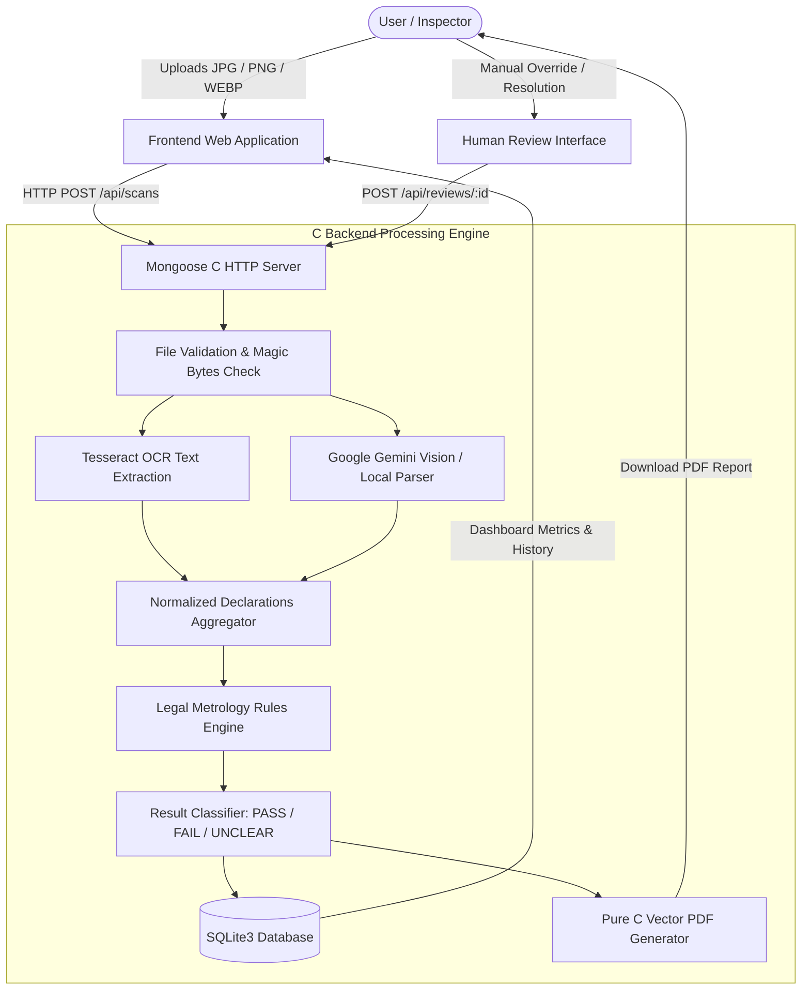

# LegalCheck 360: System Architecture & Data Flow

**Official Name:** LegalCheck 360  
**Tagline:** Smart Packaging. Smarter Compliance.  
**Target Level:** B.Tech CSE First-Year Academic Evaluation & Regulatory Production Architecture

---

## 1. High-Level Architectural Flowchart

---

## 2. Core Architectural Principles

### 1. Mandatory C Backend
- Implemented strictly in C99/C11.
- No Python, Node.js, or Java runtime in backend server execution.
- High memory efficiency, deterministic execution, and ultra-low latency (< 50ms rule evaluation time).

### 2. Separation of Extraction and Legal Decision-Making
- **AI and OCR are strictly sensory tools:** They read and transcribe printed packaging text into structured JSON.
- **AI NEVER makes the legal decision:** AI is strictly forbidden from hallucinating legal rules or deciding whether a product is compliant.
- **The deterministic C Rules Engine** holds full authority to compare extracted values against codified Indian statutory rules under the Legal Metrology (Packaged Commodities) Rules, 2011.

### 3. Graceful Offline Fallback
- If the system is offline or `GEMINI_API_KEY` is not provided, LegalCheck 360 automatically executes its deterministic local regex & packaging pattern recognition engine.
- The platform never crashes, hangs, or presents fake demonstrations.

### 4. Zero-Dependency Pure C PDF Report Generator
- Directly outputs standard Adobe PDF 1.4 vector files.
- Includes colored compliance badges, header banners, declaration tables, and mandatory regulatory disclaimers.

